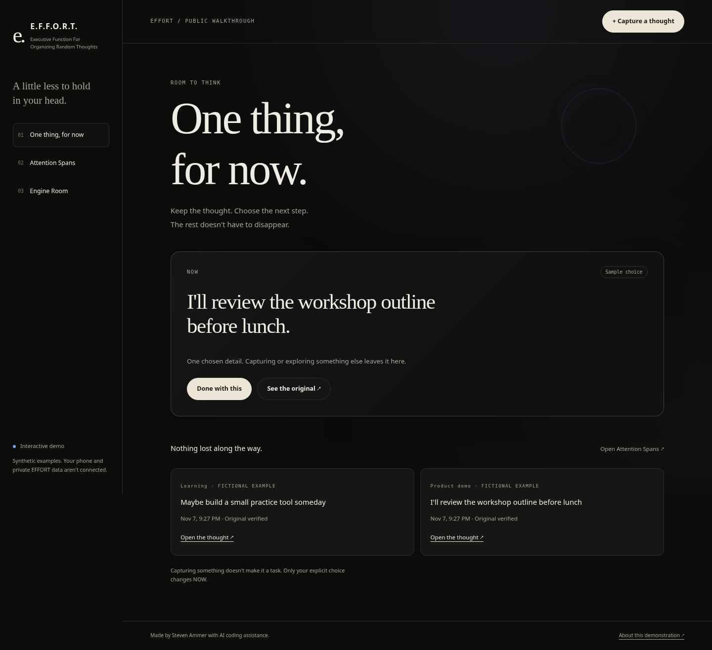

# E.F.F.O.R.T., a public walkthrough

**Capture a thought. Keep the original. Choose one next step.**

[Open the interactive walkthrough](https://stevenammer.github.io/effort-demo/). It runs in your browser with fictional sample data. No account, no backend, no API key.

E.F.F.O.R.T. (Executive Function For Organizing Random Thoughts) is my personal Android app for people whose thoughts arrive faster than they can sort them. This is a public, browser-only walkthrough of how it thinks.

## What this shows

- **Your original is never lost.** Every capture is read back and SHA-256 verified before it says SAVED. Organizing is a reversible view, never a rewrite.
- **Commitments are explicit.** Nothing becomes work by itself. You pick one next step, and finishing it leaves a self-reported receipt.
- **AI help is bounded and leaves receipts.** Helpers are off by default. You approve exact selected text and a self-hosted route, and every answer keeps its prompt, model and lineage.

## The open core (alpha)

The shared logic is also available inside this repository:

- [`packages/core`](packages/core): exact capture and readback verification, organization,
  safe reading and NOW selection, with no runtime dependencies.
- [`packages/storage`](packages/storage): append-only JSONL-file and IndexedDB adapters.
- [`apps/cli`](apps/cli): capture, list, NOW and verification from the command line.

The browser uses a generated copy of the core, checked for drift. This is an alpha library;
its common export format and further integration slices are still being specified.
The package READMEs show how to use the code from this repository.

## How it was built

I wrote the specs and decisions, agents wrote most of the code, and I red-teamed it and chose what shipped. One small example, start to finish, is in the [case study](docs/CASE_STUDY.md). The full list of attacks and defects is [RED_TEAM.md](docs/RED_TEAM.md). The running dev log, including what is verified and what isn't, is [docs/CURRENT_STATE.md](docs/CURRENT_STATE.md).



## Try it locally

Needs Node 20.20 or newer. There are no runtime package dependencies. Tests use fake-indexeddb to exercise real transaction boundaries without a browser.

```sh
npm ci
npm test
npm run dev
```

Open `http://127.0.0.1:4174/public/`. A static host can serve the same files; the root index links to the walkthrough. No API key, account or private backend is needed.

## The loop to try

1. Open a fictional example and switch between its organised view and original wording.
2. Capture a fictional thought. Close and reopen the dialog, or reload, to check its draft. Open another tab and try different writing; each tab keeps its own copy. Replies, return notes, drop reasons and new span names have drafts too.
3. Save it. The browser reads back the exact text and verifies its SHA-256 before reporting success. The existing NOW choice stays put.
4. Deliberately choose one exact quote as the next step. Marking it done preserves the original capture.
5. Open Attention Spans, create a named destination, and post in it. Open the thread, reply, then reply to that reply. Reload or follow a permalink to check the context.
6. Keep your place with a short summary and return note. Deliberately choose another step, then resume the held one. The earlier commitment and original both stay saved.
7. Mark a step done and open Proof. The receipt records your own action and is labeled self-reported. Workspace holds other commitments, return notes and drop reasons.
8. From NOW or a thread, choose **Explore safely…**. Set the dial, write a branch, and branch from it again. Distill something as an insight, open tension, or weird but alive idea. Nothing becomes work. Outside the unhinged sandbox, **Consider as a next step…** prepares the distilled writing with its lineage attached, then opens a separate explicit choice. **Choose from original…** also remains available. Return to the exact step you left.
9. Attach a file to a saved thought or reply. Read its safe text preview or download its exact bytes. Follow its file permalink, or paste its local reference into a thought in another Attention Span. Workspace keeps the connected file directory.
10. Download a demo backup in Engine Room. Clear the demo, restore the file, then restore it again. The second restore adds no duplicates. The directory, nested replies, choice histories, completion receipts, return points, exploration trees, typed distillations and draft copies survive too. Restoring an older backup doesn't reopen completed or dropped work.

[View the offline and recovery screen on a phone](docs/screens/offline-phone.png).

Once Engine Room says **Available offline**, disconnect and reopen this site's usual URL or a thread link. Capturing, drafts, reading and downloaded backups continue to work. A new release waits until you choose **Keep writing and open update**; failed draft checks pause the reload. An incomplete or mismatched app download leaves the previous offline copy intact.

## More

- [Details](docs/DETAILS.md): what comes from the actual app, data and limitations, how it was verified, and attribution.
- [Case study](docs/CASE_STUDY.md): one spec, one attack, one bug and its fix.
- [Dev log](docs/CURRENT_STATE.md): what's verified and what isn't, release by release.
- [Red-team ledger](docs/RED_TEAM.md): the attacks I tried and what they found.
